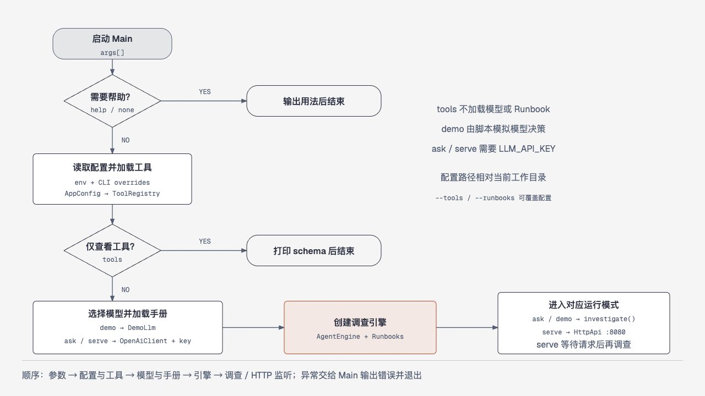
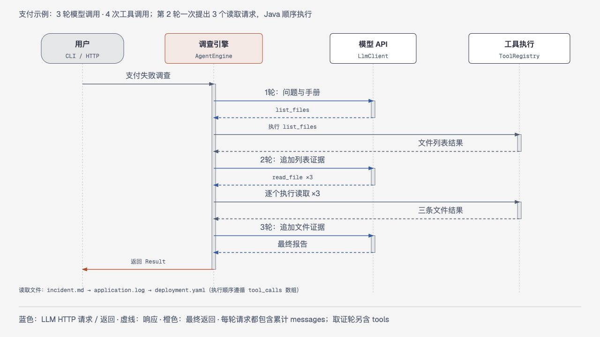
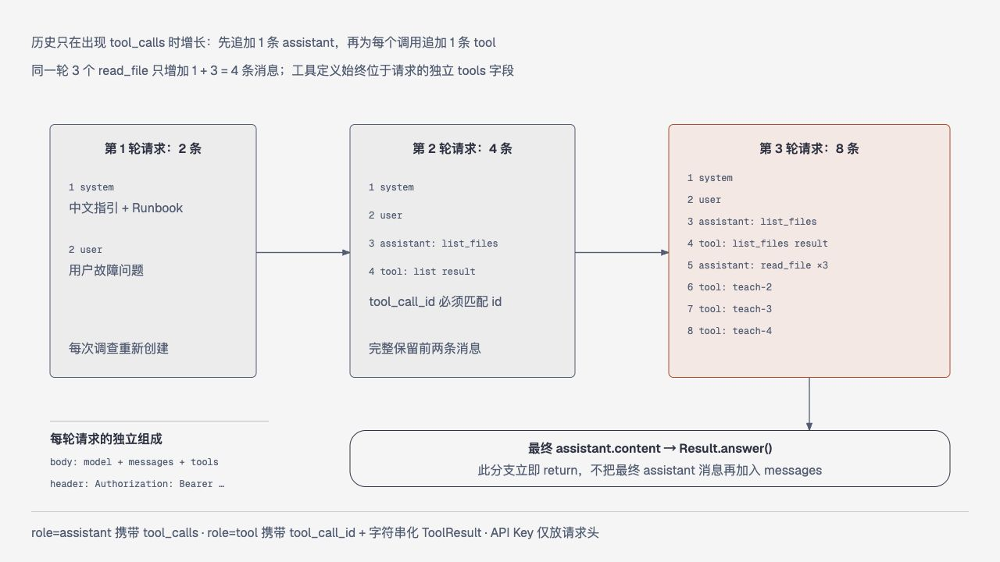
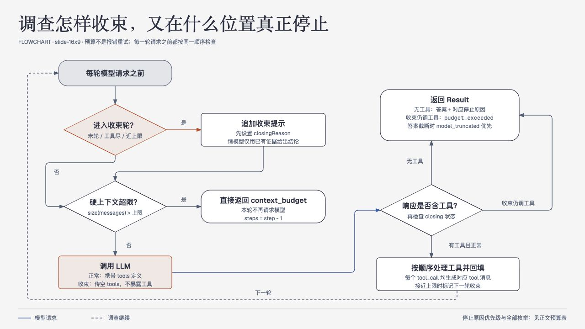
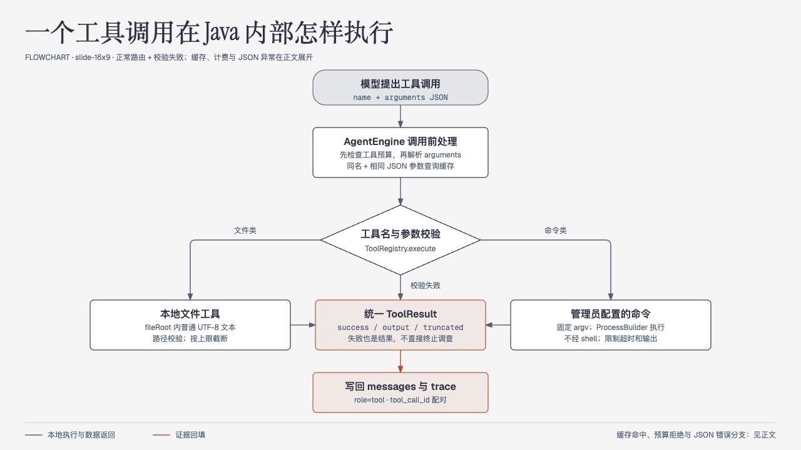
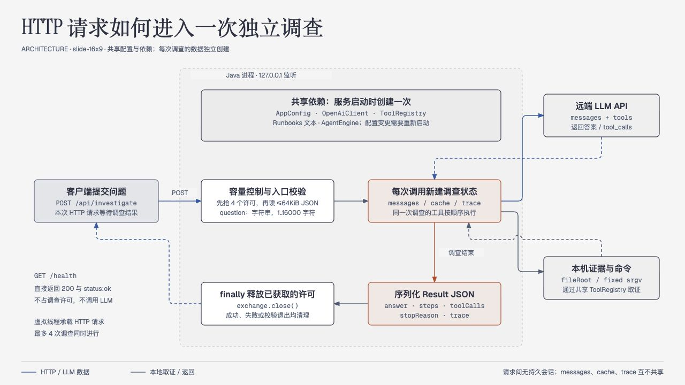

# 内部机制与数据流详解

这份详解对应当前 JDK 27 源码，补充主文档中略去的对象、消息、执行顺序与失败分支。阅读目标是：看到一个调查结果后，能解释它由哪些请求和工具证据组成；修改配置或调试程序时，知道应该在哪个类停下来观察。

本文的支付事故文件均为人工示例。此前真实模型验证确实完成了 **3 轮模型调用、4 次工具调用**；下面的 JSON 是按当前代码与示例文件重新整理的教学版本，**不是原始网络抓包，也不是本次重新调用模型的记录**。字段结构与配对方式对应代码，调用 ID、系统提示摘录、证据摘录和答案文字用于讲解。JDK 27 迁移后的验证情况以 `docs/验证记录.md` 为准。

## 七、内部机制与数据流详解

### 7.1 启动不是“直接问模型”：先准备一套可复用对象

<!-- FIGURE: startup-flow -->



[打开可缩放图表](diagrams/startup-flow.html)

从 `Main.run` 开始逐行看，执行顺序是：识别命令 → 复制进程环境 → 用 CLI 参数覆盖副本 → 生成 `AppConfig` → 加载 `ToolRegistry` → 按命令选择后续分支。程序没有自动读取 `.env` 的步骤；`.env.example` 是配置示范。`--tools`、`--runbooks`、`--max-steps`、`--port` 覆盖同名环境变量对应的配置，`--trace` 是入口内部的布尔值。

| 命令 | 真正经过的准备步骤 | 不要误解的行为 |
| --- | --- | --- |
| 无参数、`help`、`--help` | 直接打印帮助并返回 | 不读取模型配置，不加载工具和手册，不检查 Key |
| `tools` | 解析配置、校验工具、输出工具 schema 后返回 | 不创建 LLM 客户端，不加载 Runbook；仍要求工具根目录存在 |
| `demo` | 配置 → 工具 → `DemoLlm` → 加载手册 → 引擎 → 固定演示问题 | 不需要 Key；只模拟模型决策，文件工具仍真实执行 |
| `ask` | 配置 → 工具 → `OpenAiClient` → 加载手册 → 引擎 → 调查用户问题 | 缺 Key 会在客户端构造时失败；问题为空的检查更靠后 |
| `serve` | 与 `ask` 相同的准备 → `HttpApi.start` → 等待请求 | 启动时创建一个引擎；之后每次请求调用它的 `investigate` |

`OpenAiClient` 构造时只检查 Key 并创建 JDK HTTP 客户端，不发送模型请求。因此 HTTP 启动成功不说明 Key 有效或上游可达。工具加载阶段会把 `config/tools.json` 的 `fileRoot` 相对于**配置文件目录**解析，再转成真实路径；默认 `../examples/evidence` 因而落到项目的示例目录。`--tools` 和 `--runbooks` 本身的相对路径则取决于启动工作目录。

Runbook 在创建引擎时加载一次：只读目录顶层、后缀为 `.md` 的普通文件，按文件名排序，跳过符号链接文件；最多 20 个，单文件最多 80000 字节，拼接后最多 20000 字符。引擎持有拼接后的 `String`，每次调查把它附加进 system 提示。HTTP 运行中修改手册、工具配置或外部终端的环境变量，不会重建这些对象，需要重启。证据文件不同：首次执行读取工具时才访问文件；后续相同调用可能命中本次调查缓存。

### 7.2 一次调查拥有什么，哪些对象会跨请求复用

`AgentEngine` 保存 LLM 客户端、工具注册表、Runbook 字符串和三个预算值。`investigate` 内部才创建 `messages`、`trace`、`cache`、`executions` 与 `closingReason`。因此 HTTP 的多个请求复用同一个引擎和底层客户端，但它们不共享问题、消息历史、工具缓存和计数器。

| 对象 | 生命周期 | 作用 |
| --- | --- | --- |
| `AppConfig`、`ToolRegistry`、`LlmClient`、`AgentEngine` | 一次进程启动 | 固定连接参数、已校验的工具定义和规则 |
| `messages` | 单次 `investigate` | 逐步保存 system、user、assistant 工具请求与 tool 证据 |
| `cache` | 单次 `investigate` | 复用同名同参数的首次工具结果，包括失败结果 |
| `trace` | 单次 `investigate`，最后转成不可变列表返回 | 给调用者观察工具执行过程 |
| `Process`、输出读取线程 | 单次命令工具调用 | 执行一个配置命令并收集有上限的输出 |

不存在会话 ID、历史数据库或后台持续调查。把同一个问题再发一次，会从两个初始消息重新开始。每次调用模型时传入 `messages.deepCopy()`，工具定义也通过副本提供，避免客户端或调用方修改引擎已经积累的 JSON 结构；这不是历史压缩。

### 7.3 跟着支付故障走三轮：究竟发了什么、收了什么

<!-- FIGURE: investigation-sequence -->



[打开可缩放图表](diagrams/investigation-sequence.html)

教学问题是“checkout 服务发布 v2 后为什么支付失败”。文件中的三项证据应交叉验证：`incident.md` 给出变更与现象，`application.log` 给出缺少 `PAYMENT_API_URL` 及回退地址，`deployment.yaml` 给出仍使用旧变量 `PAYMENT_URL`。`pod-events.log` 属于另一服务 `queue-worker-demo`，不能把它的 OOM 记录拼进支付事故因果链。

#### 第一轮：先发现有什么证据

完整请求的外层只有 `model`、`stream`、`messages` 和非收束时的 `tools`、`tool_choice`。实际 system 包含源码里的全部约束及 Runbook；为了读清结构，下面只保留教学摘录。Authorization 在 HTTP 请求头，不在 JSON 内。

```json
{
  "model": "deepseek-v41-flash",
  "stream": false,
  "messages": [
    {"role": "system", "content": "你是 SRE 故障调查助手，请用中文分析。先用工具取证，再下结论。最终区分事实、推测和未知项。这里为教学摘录；实际还包含完整系统约束与 Runbook。"},
    {"role": "user", "content": "checkout 服务发布 v2 后为什么支付失败？"}
  ],
  "tools": [
    {"type": "function", "function": {"name": "list_files", "description": "列出证据根目录中的文本文件，路径相对于根目录。", "parameters": {"type": "object", "additionalProperties": false, "properties": {}, "required": []}}},
    {"type": "function", "function": {"name": "read_file", "description": "读取证据目录内的 UTF-8 文本文件；使用相对路径。", "parameters": {"type": "object", "additionalProperties": false, "properties": {"path": {"type": "string", "description": "要读取的相对路径", "minLength": 1, "maxLength": 512}}, "required": ["path"]}}},
    {"type": "function", "function": {"name": "search_files", "description": "在证据目录的 UTF-8 文本中搜索字面字符串，返回路径、行号和匹配行。", "parameters": {"type": "object", "additionalProperties": false, "properties": {"query": {"type": "string", "description": "要查找的字面字符串（忽略大小写）", "minLength": 1, "maxLength": 200}}, "required": ["query"]}}}
  ],
  "tool_choice": "auto"
}
```

供应商响应中，引擎实际关注 `choices[0].message` 和 `finish_reason`：

```json
{
  "choices": [{
    "message": {
      "role": "assistant",
      "content": null,
      "tool_calls": [{"id": "teach-1", "type": "function", "function": {"name": "list_files", "arguments": "{}"}}]
    },
    "finish_reason": "tool_calls"
  }]
}
```

注意 `arguments` 是**装着 JSON 的字符串**，不是直接嵌套的对象。Java 先验证调用协议，再把完整 assistant 消息加入历史，随后解析这个字符串并执行 `list_files`。执行结果成为下一条消息：

```json
{
  "role": "tool",
  "tool_call_id": "teach-1",
  "content": "{\"success\":true,\"output\":\"application.log\\ndeployment.yaml\\nincident.md\\npod-events.log\\n\",\"truncated\":false}"
}
```

这里有第二层编码：`content` 也是字符串，字符串内部才是序列化后的 `ToolResult`。模型不是读取一个独立 `output` 顶层字段，而是从 tool 消息正文看见结果 JSON。`tool_call_id` 必须等于前面调用的 `id`；工具名称不能替代 ID。

#### 第二轮：带着四条历史读取三份材料

第二轮仍发送上面相同的 `model`、`stream`、`tools` 和 `tool_choice`；变化的是 `messages`，其完整组成如下。system 与问题与第一轮一致，这里使用同一教学摘录。

```json
[
  {"role": "system", "content": "你是 SRE 故障调查助手，请用中文分析。先用工具取证，再下结论。最终区分事实、推测和未知项。这里为教学摘录；实际还包含完整系统约束与 Runbook。"},
  {"role": "user", "content": "checkout 服务发布 v2 后为什么支付失败？"},
  {"role": "assistant", "content": null, "tool_calls": [{"id": "teach-1", "type": "function", "function": {"name": "list_files", "arguments": "{}"}}]},
  {"role": "tool", "tool_call_id": "teach-1", "content": "{\"success\":true,\"output\":\"application.log\\ndeployment.yaml\\nincident.md\\npod-events.log\\n\",\"truncated\":false}"}
]
```

模型现在知道文件名称，可在一个 assistant 消息内提出三个请求：

```json
{
  "choices": [{
    "message": {
      "role": "assistant",
      "content": "我会交叉检查事故说明、运行日志和部署配置。",
      "tool_calls": [
        {"id": "teach-2", "type": "function", "function": {"name": "read_file", "arguments": "{\"path\":\"incident.md\"}"}},
        {"id": "teach-3", "type": "function", "function": {"name": "read_file", "arguments": "{\"path\":\"application.log\"}"}},
        {"id": "teach-4", "type": "function", "function": {"name": "read_file", "arguments": "{\"path\":\"deployment.yaml\"}"}}
      ]
    },
    "finish_reason": "tool_calls"
  }]
}
```

这句话不是最终答案，因为存在非空 `tool_calls`。Java 先追加该 assistant，再按数组顺序执行三次 `read_file`；当前实现没有把它们并行化。三个 tool 结果全部补齐后，才进入下一次模型调用。即使其中一个读取失败，也应为那个 ID 补上失败的 tool 结果，而不是跳过，避免破坏请求与结果配对。

#### 第三轮：八条历史已经组成证据链

下面是第三轮 `messages` 的完整八条结构。为了突出字段与配对，三个 `output` 只摘录真实示例文件中的关键行；实际工具返回受上限约束的文件全文，不由引擎自动抽取这些摘要。第一轮外层模板的其余字段保持相同；这是正常第三轮，仍开放工具，并非因为“第三轮”就强制收束。

```json
[
  {"role": "system", "content": "你是 SRE 故障调查助手，请用中文分析。先用工具取证，再下结论。最终区分事实、推测和未知项。这里为教学摘录；实际还包含完整系统约束与 Runbook。"},
  {"role": "user", "content": "checkout 服务发布 v2 后为什么支付失败？"},
  {"role": "assistant", "content": null, "tool_calls": [{"id": "teach-1", "type": "function", "function": {"name": "list_files", "arguments": "{}"}}]},
  {"role": "tool", "tool_call_id": "teach-1", "content": "{\"success\":true,\"output\":\"application.log\\ndeployment.yaml\\nincident.md\\npod-events.log\\n\",\"truncated\":false}"},
  {"role": "assistant", "content": "我会交叉检查事故说明、运行日志和部署配置。", "tool_calls": [
    {"id": "teach-2", "type": "function", "function": {"name": "read_file", "arguments": "{\"path\":\"incident.md\"}"}},
    {"id": "teach-3", "type": "function", "function": {"name": "read_file", "arguments": "{\"path\":\"application.log\"}"}},
    {"id": "teach-4", "type": "function", "function": {"name": "read_file", "arguments": "{\"path\":\"deployment.yaml\"}"}}
  ]},
  {"role": "tool", "tool_call_id": "teach-2", "content": "{\"success\":true,\"output\":\"发布 checkout-api:v2 后，HTTP 500 错误率从 0.1% 上升到 18%。\",\"truncated\":false}"},
  {"role": "tool", "tool_call_id": "teach-3", "content": "{\"success\":true,\"output\":\"WARN configuration key=PAYMENT_API_URL missing=true fallback=http://localhost:8081\\nERROR endpoint=/checkout payment_url=http://localhost:8081 error=ConnectionRefused status=500\",\"truncated\":false}"},
  {"role": "tool", "tool_call_id": "teach-4", "content": "{\"success\":true,\"output\":\"image: example.invalid/checkout-api:v2\\nenv:\\n  - name: PAYMENT_URL\\n    value: http://payment-service:8080\",\"truncated\":false}"}
]
```

假设第三轮返回如下结构，程序便直接结束：

```json
{
  "choices": [{
    "message": {
      "role": "assistant",
      "content": "现象：checkout v2 发布后支付失败。证据：日志提示 PAYMENT_API_URL 缺失，部署仍使用 PAYMENT_URL；支付请求回退到 localhost:8081 后 ConnectionRefused。可能根因：变量名不一致导致支付地址配置失效。建议：核对并修正部署变量，再验证新 Pod 环境与支付链路。未知项：示例证据不能证明真实生产已修复；另一服务的 OOM 记录与本事故没有直接证据关联。"
    },
    "finish_reason": "stop"
  }]
}
```

代码在无工具且答案非空时直接返回 `Result`，**不会把这条最终 assistant 再追加进 messages**，也不会持久化全部历史。所以三次模型请求的历史条数是 **2 → 4 → 8**，而不是 2 → 4 → 8 → 9 后再发送一次。这里的结果计数为 `steps=3`、`toolCalls=4`、`trace.size=4`、`stopReason=completed`。可直接核对 [无工具答案的返回位置](https://github.com/allenflux/holmesJpt/blob/2f5b88fa89d3e71ba5b040f9498cbe62dab11f0d/src/main/java/dev/holmes/AgentEngine.java#L69) 和 [assistant 入历史的位置](https://github.com/allenflux/holmesJpt/blob/2f5b88fa89d3e71ba5b040f9498cbe62dab11f0d/src/main/java/dev/holmes/AgentEngine.java#L87)。

<!-- FIGURE: message-history -->



[打开可缩放图表](diagrams/message-history.html)

### 7.4 计数、缓存和 trace：三个数字不能混着看

`steps` 是调查循环已经调用模型的轮次，包含最终答案轮与预算收束轮。`toolCalls` 来自 `executions`：一次新工具尝试计 1，参数字符串无法解析也计 1；已经找到缓存则不增加。`trace` 对每一个本轮模型提出的调用记一条，包含缓存复用与预算拒绝，因此它可能多于 `toolCalls`。

缓存匹配条件是“相同工具名称 + `JsonNode.equals` 深相等”，不是比较原始 arguments 字符串。对象字段顺序和无意义空白不同，只要解析成相等 JSON 就能复用。成功、未知工具、schema 校验失败和命令失败等已经返回的 `ToolResult` 都会缓存；无法解析成 JSON 对象的参数在缓存之前失败，不保存。缓存没有 TTL，也不会检查文件修改时间；同一次调查里，读文件失败后文件刚好出现，再读相同路径仍会复用第一次失败。

判断顺序尤其重要：**先看工具预算是否已用尽，未用尽时才解析参数、查缓存**。例如上限为 1，第一条调用执行成功后，第二条即使完全相同也收到“工具调用预算已到，本次未执行”，而不是缓存结果。该拒绝会补 tool 消息并记 trace，但不再增加 `executions`。

| trace 字段 | 应如何解读 |
| --- | --- |
| `step`、`tool` | 哪一模型轮提出了哪个工具 |
| `success` | 工具结果是否成功；不能替代结论正确性 |
| `truncated` | 输出或证据覆盖可能不完整；不等于模型答案截断 |
| `reused` | 是否拿到本次调查较早的缓存结果 |
| `durationMs` | 本次解析、查缓存或执行的耗时；不是 LLM 延迟 |
| `output` | 最后交给模型的工具输出文本 |

trace **不保存 arguments**，不是完整命令审计，也不是模型内部思维。CLI 只有加 `--trace` 才在答案后打印它；HTTP 的 `Result` 则始终带 trace。当前没有持久化轨迹或日志脱敏模块，保存 trace 前应确认工具输出内容适合保存。

### 7.5 停止判断的准确位置：先配对，再尝试收束

<!-- FIGURE: budget-stop -->



[打开可缩放图表](diagrams/budget-stop.html)

默认预算是 8 个模型轮次、24 次新工具尝试、120000 个上下文字符。每轮开始，若 `step == maxSteps`、工具预算已到或已有 `closingReason`，进入收束：先追加一条 user“调查预算已到……”提示，再检查总字符数。能发送才调用模型，并传入空工具数组；`OpenAiClient` 因而**同时省略 `tools` 与 `tool_choice`**，没有发送 `tool_choice: none`。

默认第 8 轮属于最终收束，至多前 7 轮开放工具。模型可以更早直接回答。每批工具执行完毕才判断历史是否超过 `maxContextChars - 256`：超过则把下一轮标为 `context_budget`。这里预留的是字符空间，不是固定 token 数；工具结果配对先完成，不会为了凑大小删除一半 tool 消息。

如果收束提示追加后历史已经超过上限，返回固定的“不完整结论”说明，`steps` 为 `step - 1`，因为这一轮没有请求模型。初始问题加手册就超限则抛参数异常。这个实现没有历史压缩、摘要替换或自动删旧消息；上下文大小是 `messages.toString().length()`，包含 JSON 转义和结构，不包括独立的 tools schema，也不等于 UTF-8 字节数或服务商 token 计费。

| 分支 | 行为与结果 |
| --- | --- |
| 正常无工具、非空答案 | `completed` |
| 因最后一轮或工具预算关闭工具，模型返回答案 | `step_budget` 或 `tool_budget` |
| 靠近上下文上限后模型成功给答案 | `context_budget`，需阅读正文判断完整性 |
| 已经超过上下文上限，不再调用模型 | `context_budget`，固定说明未生成完整结论 |
| 收束轮仍返回非空 tool_calls | 不执行，返回 `budget_exceeded` |
| 无工具答案的 `finish_reason` 是 `length` | `model_truncated`，此标记优先于此前收束原因 |

非收束轮单个 assistant 最多允许 32 个工具调用，超过是协议错误，不是工具失败。总预算可能在一批中间耗尽：剩余调用各补失败结果，之后才能带完整配对历史收束。只在同一个 assistant 消息内检查 ID 非空且不重复，并验证 `type=function`、`function` 为对象；代码没有全历史 ID 注册表。

需要分清两类失败。非法 `tool_calls` 结构、角色错误、没有答案也没工具等属于模型协议错误，会抛 `IOException` 终止；读取不到文件、未知工具或参数不符合 schema 等通常转成 `success=false` 的 tool 消息，仍可交给模型继续调查。后者不是 HTTP 502 的同义词。

### 7.6 模型客户端：一次“模型轮次”可能含三次网络尝试

`OpenAiClient` 去掉 Base URL 尾部斜线后追加 `/chat/completions`；不自动补 `/v1`。请求始终 `stream=false`，没有 SSE 流、响应增量回调或工具流式解析。客户端禁止重定向，避免把带凭据的请求转发到其他地址；配置只接受 HTTPS，或 `localhost`、`127.0.0.1` 的 HTTP 测试地址。

连接超时固定 15 秒；每次网络尝试受 `LLM_TIMEOUT_SECONDS` 约束，默认 90 秒，等待范围包含响应体读取。接收器边读边限制 **响应体**最多 2 MiB，失败响应也先经过该限制。请求没有“2 MiB 请求上限”，而是由调查消息字符预算间接约束，工具定义还会额外占请求空间。

只有 HTTP 429、502、503、504 在尚有次数时重试；最多 3 次尝试，中间等待 250 毫秒、500 毫秒。网络异常、超时、无效 JSON和协议错误不自动重试。三个尝试属于同一 `complete`，不会把 `steps` 加三；每个尝试各有超时，不能把 90 秒当成整次调查总 deadline。多轮、命令工具和短暂退避会继续增加总耗时。

响应只读取 `choices[0]`；要求 message 是对象且 role 为 assistant，复制后交给引擎继续验证。客户端没有解析 usage、持久化请求或保存完整响应。错误响应原文不打印，网络和解码错误转换成统一描述，避免供应商回显请求或密钥；`AppConfig.toString()` 也隐藏 Key。但这不是全内容脱敏：文件或命令主动输出的敏感信息仍可能进入模型与 trace。

### 7.7 新工具怎样从配置走到进程：schema 不是装饰

<!-- FIGURE: tool-execution -->



[打开可缩放图表](diagrams/tool-execution.html)

以仓库 `k8s_get_pods` 为例，配置中 `namespace` 声明 string、长度上限 63、Kubernetes 名称正则，加入 required，argv 是固定顺序的字符串数组。启动时 `parseCommand` 检查受支持的 schema 子集：只允许 string 参数，必须有 pattern 或 enum，额外参数禁止，每个参数都必须为必填且用于占位符，可执行文件名不能有占位符。它不是完整 JSON Schema 通用实现。

```json
{
  "name": "k8s_get_pods",
  "description": "列出指定命名空间的 Pod 状态（只读）。",
  "parameters": {
    "type": "object",
    "properties": {
      "namespace": {"type": "string", "pattern": "[a-z0-9](?:[a-z0-9-]{0,61}[a-z0-9])?", "maxLength": 63}
    },
    "required": ["namespace"]
  },
  "argv": ["kubectl", "get", "pods", "--namespace", "{namespace}", "--output", "wide", "--request-timeout=15s"]
}
```

模型提交 `arguments="{\"namespace\":\"demo-shop\"}"` 后，执行阶段再次拒绝未知字段、漏填字段、非字符串、长度不符、控制字符、命令参数以 `-` 开头、pattern 或 enum 不符。校验通过才逐个 argv token 替换，最终是下面八个独立参数，不是拼成一句 shell 文本：

```text
[0] kubectl
[1] get
[2] pods
[3] --namespace
[4] demo-shop
[5] --output
[6] wide
[7] --request-timeout=15s
```

`ProcessBuilder(argv)` 不会自动调用 shell，参数空格、分号和 `$()` 不会自动变成新命令。管理员仍能配置一个 shell 解释器或有写权限的程序，因此“只读”由工具配置与实际账户权限共同保证；代码没有通用地识别并阻止所有修改操作。命令工作目录为 `fileRoot`，这只指定工作目录，**不把外部程序限制在该目录内**；它可以按 Java 进程的权限访问文件、集群和网络。

子进程环境删除 `LLM_`、`OPENAI_`、`HOLMES_`、`SERVER_` 前缀及列出的模型 Key 名；其他环境保留，以便 kubeconfig、云认证等继续可用。它不是清空全部秘密，也不会扫描命令输出中的凭据。应使用适当权限的认证并控制命令自身返回的数据。

stdout 与 stderr 合并；独立虚拟线程持续排空管道，仅保留字符上限内的内容，超出标记 `truncated`，防止输出过多导致无限积累。主线程约每 50 毫秒观察进程退出和后代，超时先终止记录到的进程树，再对存活进程强制结束。父进程退出但子进程占着管道时也限制读取等待；这属于对观察到后代的清理，不是操作系统隔离或对任意脱离进程的绝对保证。

三个文件工具另有范围规则：拒绝绝对路径、`..`、路径中的符号链接和根目录外真实路径；只读普通 UTF-8 文本，读取前再次核验。扫描最多 2000 条目、深度 12，单文件 256 KiB，列表/搜索累计读取 8 MiB，最后再按输出字符上限裁剪。`search_files` 是忽略大小写的字面匹配，返回路径、行号、匹配行，不支持正则；列表和搜索会跳过不可读或非文本文件，缺失项不等于文件不存在。

### 7.8 HTTP 请求的一生：并发许可从什么时候占用

<!-- FIGURE: http-lifecycle -->



[打开可缩放图表](diagrams/http-lifecycle.html)

服务器绑定 `127.0.0.1`，backlog 为 16，执行器为每个任务创建虚拟线程。调查处理器先核对精确路径和 POST，再用 `Semaphore(4).tryAcquire()` 取得许可；**取得许可后才读请求体**。有四个请求持有许可时，新调查立即返回 429，不进入持久队列。读取、校验、模型调用和结果写回期间都持有许可；finally 中释放并关闭 exchange。

请求最多读 65537 字节，以检测是否超过 64 KiB；有效 JSON 必须是对象，question 必须是字符串，之后引擎再检查非空与 16000 字符上限。没有检查 Content-Type，也没有拒绝额外 JSON 字段。成功返回整个 Result，调查停止原因仍需由客户端检查；HTTP 200 不代表证据充分或调查完整。

| 状态码 | 本实现的触发位置 |
| --- | --- |
| 400 | JSON/字段/问题或上下文初始参数不合法 |
| 405 | 注册接口使用了错误方法 |
| 413 | 调查请求体超过 64 KiB |
| 429 | 四个调查许可均已占用 |
| 502 | 引擎抛出 LLM 网络、供应商或协议 IOException |
| 503 | 调查抛出 InterruptedException |
| 500 | 其他未处理 RuntimeException |

`/health` 不占调查许可，返回本地服务存活状态，不探测模型或工具。注册上下文采用路径前缀匹配，处理器另行核对精确路径：例如 `/health/extra` 的 404 由本程序写 JSON；完全没有匹配上下文的 `/missing` 则交给 JDK 默认 404，不能保证它有同样的 JSON 错误结构。程序自己的 JSON 响应带 `Content-Type: application/json; charset=utf-8` 与 `Cache-Control: no-store`。

当前没有请求体读取超时、整次调查总超时、取消接口、身份认证或持久任务队列。慢请求可能在读 body 阶段占住许可；客户端断开也没有完整的主动取消链路。主进程注册 shutdown hook 调用 `server.stop(1)`，不应把这理解为已实现所有运行中任务的优雅取消。

### 7.9 从启动到断点：一条可以实际跟读的路线

下表链接固定到 Java 仓库 `allenflux/holmesJpt` 的 `2f5b88fa89d3e71ba5b040f9498cbe62dab11f0d` 版本，便于日后代码变化时仍能复现本页讲解。文件路径与行号已按当前源码核对。

| 阅读目标 | 文件与入口行 | 建议观察 |
| --- | --- | --- |
| 启动分支和参数覆盖 | [Main.java:17](https://github.com/allenflux/holmesJpt/blob/2f5b88fa89d3e71ba5b040f9498cbe62dab11f0d/src/main/java/dev/holmes/Main.java#L17) | `command`、env 副本、先 tools 后 llm 的顺序 |
| 默认值和合法范围 | [AppConfig.java:15](https://github.com/allenflux/holmesJpt/blob/2f5b88fa89d3e71ba5b040f9498cbe62dab11f0d/src/main/java/dev/holmes/AppConfig.java#L15) | 字符预算与字节上限分属不同层 |
| 生成可用工具 | [ToolRegistry.java:59](https://github.com/allenflux/holmesJpt/blob/2f5b88fa89d3e71ba5b040f9498cbe62dab11f0d/src/main/java/dev/holmes/tools/ToolRegistry.java#L59) | `fileRoot` 真实路径、definitions |
| 手册一次加载 | [Runbooks.java:13](https://github.com/allenflux/holmesJpt/blob/2f5b88fa89d3e71ba5b040f9498cbe62dab11f0d/src/main/java/dev/holmes/Runbooks.java#L13) | paths 排序、拼接后的 text |
| 初始消息 | [AgentEngine.java:29](https://github.com/allenflux/holmesJpt/blob/2f5b88fa89d3e71ba5b040f9498cbe62dab11f0d/src/main/java/dev/holmes/AgentEngine.java#L29) | messages 两条、初始大小 |
| 循环与收束 | [AgentEngine.java:52](https://github.com/allenflux/holmesJpt/blob/2f5b88fa89d3e71ba5b040f9498cbe62dab11f0d/src/main/java/dev/holmes/AgentEngine.java#L52) | step、executions、closingReason |
| 协议校验与证据回填 | [AgentEngine.java:80](https://github.com/allenflux/holmesJpt/blob/2f5b88fa89d3e71ba5b040f9498cbe62dab11f0d/src/main/java/dev/holmes/AgentEngine.java#L80) | assistant 先入历史、再逐个 tool |
| 缓存及轨迹 | [AgentEngine.java:93](https://github.com/allenflux/holmesJpt/blob/2f5b88fa89d3e71ba5b040f9498cbe62dab11f0d/src/main/java/dev/holmes/AgentEngine.java#L93) | previous、reused、trace 大小 |
| HTTP 出站体和重试 | [OpenAiClient.java:36](https://github.com/allenflux/holmesJpt/blob/2f5b88fa89d3e71ba5b040f9498cbe62dab11f0d/src/main/java/dev/holmes/OpenAiClient.java#L36) | body、attempt；避免展开 Authorization |
| 文件路径边界 | [ToolRegistry.java:202](https://github.com/allenflux/holmesJpt/blob/2f5b88fa89d3e71ba5b040f9498cbe62dab11f0d/src/main/java/dev/holmes/tools/ToolRegistry.java#L202) | relative、resolved、real |
| 命令替换与进程管理 | [ToolRegistry.java:259](https://github.com/allenflux/holmesJpt/blob/2f5b88fa89d3e71ba5b040f9498cbe62dab11f0d/src/main/java/dev/holmes/tools/ToolRegistry.java#L259) | argv 各元素、退出码、truncated |
| 入站请求与许可 | [HttpApi.java:33](https://github.com/allenflux/holmesJpt/blob/2f5b88fa89d3e71ba5b040f9498cbe62dab11f0d/src/main/java/dev/holmes/HttpApi.java#L33) | acquired、body 长度、finally |

给引擎的 63、87、112、117、74 行加断点，可以逐步看见支付教学案例中的变量变化；断点是观察程序状态，不需要读取模型内部思维。

| 暂停位置 | 第 1 轮 | 第 2 轮 | 第 3 轮 |
| --- | --- | --- | --- |
| 63 行调用模型前 | `step=1`，messages=2，executions=0 | `step=2`，messages=4，executions=1 | `step=3`，messages=8，executions=4 |
| 87 行添加 assistant 后 | messages=3；calls.size=1 | messages=5；calls.size=3 | 不经过这里：无工具直接返回 |
| 每次 112 行添加 tool 后 | messages=4，trace 随后变 1 | messages 依次为 6、7、8，trace 随后变 2、3、4 | 无新增 tool |
| 117 行批次结束 | cache=1，executions=1 | cache=4，executions=4 | 无工具，不经过这里 |
| 74 行正常返回前 | 本案例不会返回 | 本案例不会返回 | steps=3，toolCalls=4，trace=4 |

正常预算充足时，三轮的 `closing=false`、`closingReason=null`。在 IDE 中先暂停于第 63 行，再单步越过 `llm.complete`，可以区分“等待模型”和“运行工具”的耗时；只展开 `messages`、calls、output 等对象，避免把配置中的密钥或 Authorization 截图保存。

调试前先区分构建期与运行期。`pom.xml` 的 release=27 决定编译目标；`mvn -version` 显示 Maven 真正使用的 JDK；`java -version` 显示当前终端启动 JAR 的运行时。IDE 的 Project SDK、Maven Runner JRE 和运行配置 JRE 也要分别确认。编译时报 release 不支持通常是 Maven JDK 太旧；运行时报 class version 不支持则是启动 JAR 的 Java 太旧。

第一次 Maven 构建可能下载插件和 Jackson/JUnit 依赖；`demo` 的“离线”只保证调查时不用模型网络，不代表一个没有依赖缓存的电脑能离线构建。先构建，再执行 `tools` 确认配置，随后用 `demo --trace` 在引擎中观察 2→4→6 的消息请求条数：离线脚本先列文件，再只读 `pod-events.log`，第三轮返回答案，因此其工具数是 2；不要拿它与支付案例的 2→4→8、4 次工具混淆。

已有 `docs/验证记录.md` 记录 JDK 27 构建、35 项自动测试通过和离线 demo；本次文档补充没有再次调用外部 LLM。需要自己复现时，可先运行 `mvn test`，重点跟读 [AgentEngineTest](https://github.com/allenflux/holmesJpt/blob/2f5b88fa89d3e71ba5b040f9498cbe62dab11f0d/src/test/java/dev/holmes/AgentEngineTest.java#L1) 的消息配对、重复调用、预算与截断案例，再看 HTTP 和模型客户端测试的协议失败分支。测试能验证程序行为，不能证明生产事故已经修复。

真实问题调试时，先看 trace 是否实际取得相关对象与时间窗口，再检查 success/truncated/reused。如果现有证据不足，应补采样窗口、部署版本、服务关联、实际环境变量或指标；重复同名同参数读取不会刷新缓存。要验证修复，需要修改后的新证据和新调查；当前项目没有修改部署并验证修复的自动闭环。

最后沿失败层定位：入口错误看 Main/AppConfig；工具无法注册看 load/parseCommand；取证失败看 ToolResult；网络或响应结构看 OpenAiClient；停止过早看引擎预算与 history 大小；不可信结论看是否跨事故拼接或证据不充分。模型回答是证据辅助分析，不替代源码、运行记录与后续验证。
